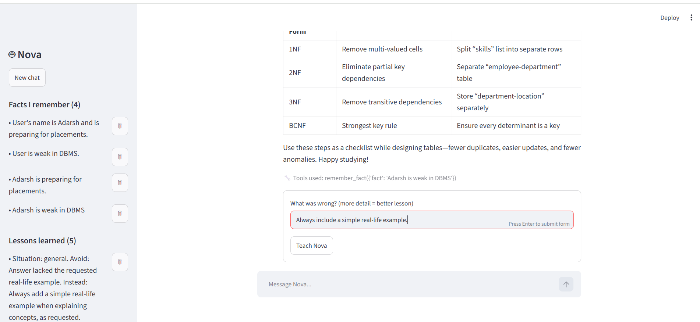

# Nova: A Self-Learning AI Agent

A study assistant that **learns from its own mistakes**. It remembers facts about you, uses tools, and turns 👎 feedback into lessons that change its future answers, with no code changes.



## How the self-learning works

1. You chat. Nova can call tools (notes, calculator, memory).
2. You click 👍 or 👎 on an answer.
3. On 👎, a second AI call **reflects** on what went wrong and writes a structured lesson (`mistake` → `better_approach`).
4. The lesson is stored in a **vector database** (ChromaDB).
5. On every new question, Nova **retrieves the most relevant lessons and facts by meaning** and adds them to its prompt.

The model itself is never retrained. The agent improves because its memory changes.

## Features

- Agent loop with tool calling (multi-step reasoning)
- Persistent long-term memory (facts and lessons) with semantic search (RAG)
- Feedback-driven self-reflection with validated structured output (Pydantic)
- Streamlit chat UI with a memory sidebar (view and delete memories)
- Safe calculator (AST-based, no `eval`), error handling, and logging

## Tech stack

Python, Groq API (OpenAI-compatible), ChromaDB, Pydantic, Streamlit

## Project structure

```
app.py               Streamlit interface
agent/
  config.py          settings and logging
  llm.py             API client
  memory.py          vector database (facts and lessons)
  tools.py           tools the agent can call
  reflection.py      turns feedback into lessons
  core.py            the agent loop
learning_steps/      my step-by-step learning scripts
```

## Setup

```bash
git clone https://github.com/YOUR_USERNAME/self_learning_agent.git
cd self_learning_agent
python -m venv venv
venv\Scripts\activate        # Windows
pip install -r requirements.txt
copy .env.example .env       # then add your Groq API key
streamlit run app.py
```

Get a free API key from [console.groq.com](https://console.groq.com). The first run downloads a small embedding model, so it is slow once.

## Limitations and future work

- Lessons are retrieved by similarity only, with no relevance threshold yet
- Memory is stored locally (could move to a cloud vector database)
- No user accounts, so it is a single-user app
- Small models sometimes ignore lessons

## What I learned

Building this taught me LLM APIs, tool calling, agent loops, structured outputs, embeddings and vector search, and basic software structure.